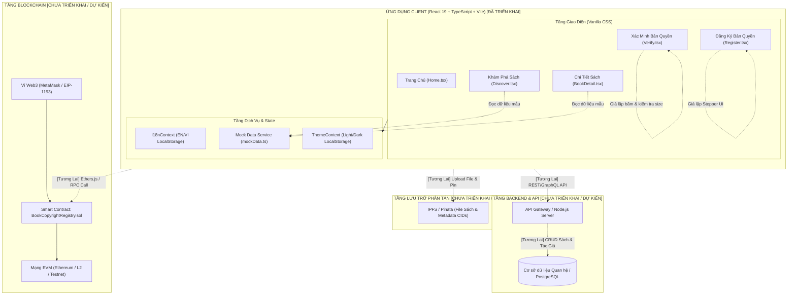
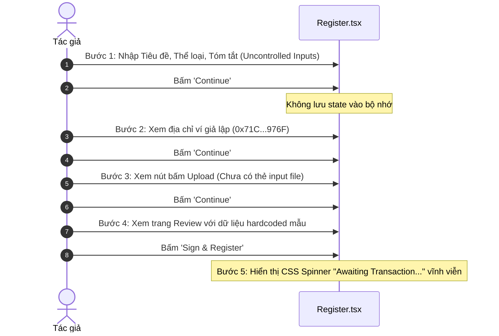
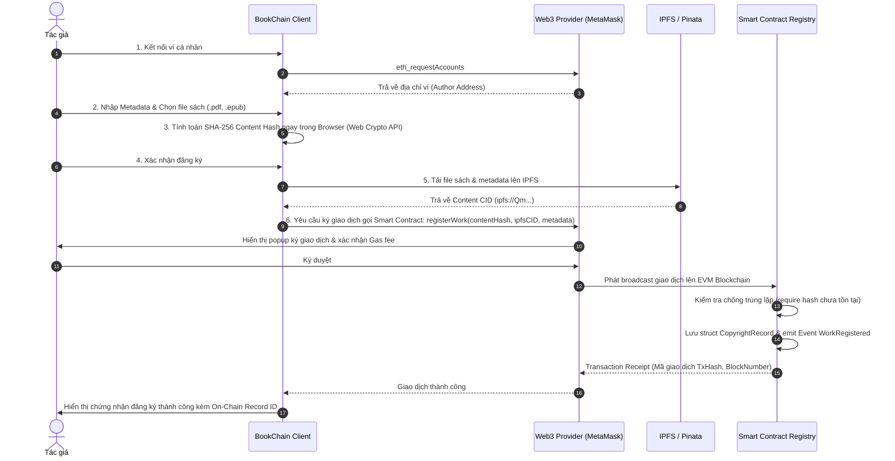
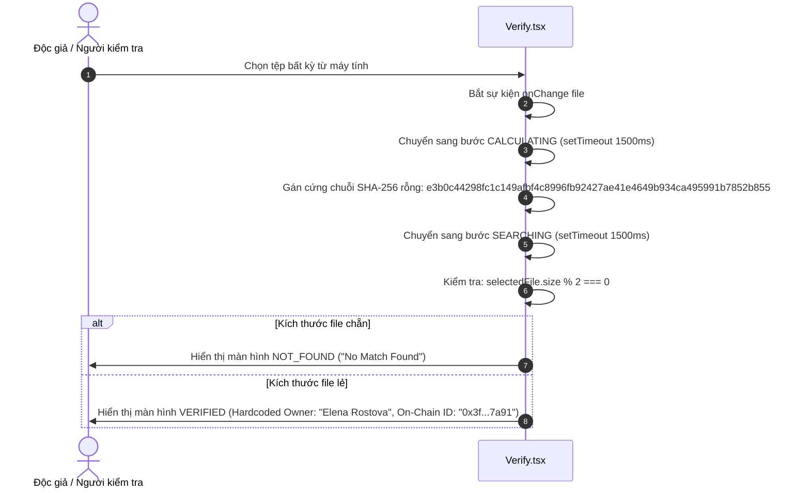
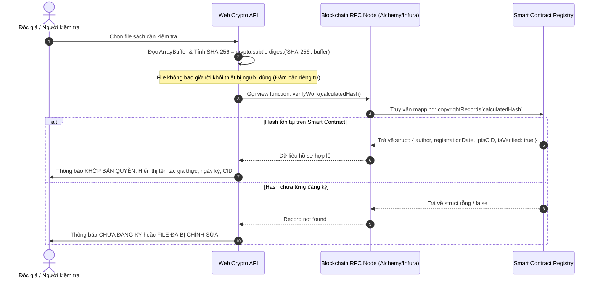
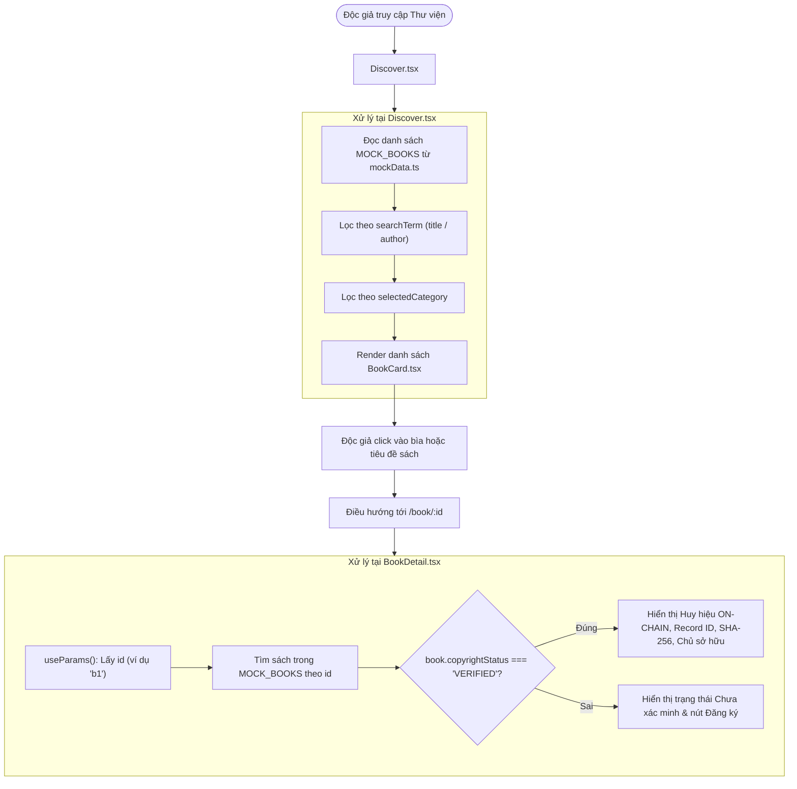

# ARCHITECTURE AND DATA FLOW — BOOKCHAIN LIBRARY
*(Tài liệu Kiến trúc Hệ thống, Phân rã Module và Luồng Dữ liệu)*

> **Phiên bản tài liệu:** 1.0.0  
> **Phạm vi:** Đối chiếu giữa kiến trúc triển khai thực tế (As-Built) và kiến trúc thiết kế mục tiêu (Target Architecture).

---

## 1. SƠ ĐỒ KIẾN TRÚC TỔNG THỂ

Biểu đồ dưới đây thể hiện ranh giới rõ ràng giữa các thành phần **đã triển khai thực tế** trong mã nguồn và các thành phần **dự kiến trong tương lai**.

---

## 2. PHÂN TÍCH LUỒNG DỮ LIỆU ĐĂNG KÝ BẢN QUYỀN (REGISTER FLOW)

### 2.1. Luồng thực tế hiện tại (Simulated MVP)
Hiện tại, chức năng đăng ký tại [Register.tsx](file:///c:/Users/tien/Desktop/H%E1%BB%8Dc/C%C3%B4ng%20Ngh%E1%BB%87%20BlockChain/C%C3%B4ng%20ngh%C3%AA%20BlockChain/B%E1%BA%A3n%20Quy%E1%BB%81n%20T%C3%A1c%20Gi%E1%BA%A3%20S%C3%A1ch/src/pages/Register.tsx) là một quy trình Stepper 5 bước chỉ có giao diện tĩnh:

### 2.2. Luồng thiết kế chuẩn mục tiêu (Target Production Flow)
Khi tích hợp Web3 và IPFS trong giai đoạn tới, luồng đăng ký cần được triển khai như sau:

---

## 3. PHÂN TÍCH LUỒNG DỮ LIỆU XÁC MINH BẢN QUYỀN (VERIFY FLOW)

### 3.1. Luồng thực tế hiện tại (Simulated MVP)
Chức năng xác minh tại [Verify.tsx](file:///c:/Users/tien/Desktop/H%E1%BB%8Dc/C%C3%B4ng%20Ngh%E1%BB%87%20BlockChain/C%C3%B4ng%20ngh%C3%AA%20BlockChain/B%E1%BA%A3n%20Quy%E1%BB%81n%20T%C3%A1c%20Gi%E1%BA%A3%20S%C3%A1ch/src/pages/Verify.tsx):

### 3.2. Luồng thiết kế chuẩn mục tiêu (Target Production Flow)
Khi tích hợp Smart Contract và Web Crypto API:

---

## 4. LUỒNG TRUY CẬP VÀ HIỂN THỊ CHI TIẾT SÁCH (DISCOVER & BOOK DETAIL)

---

## 5. PHÂN BỔ DỮ LIỆU: ON-CHAIN VS OFF-CHAIN (MÔ HÌNH THIẾT KẾ)

Nhằm tối ưu chi phí lưu trữ (Gas optimization) và đảm bảo tính bất biến, hệ thống BookChain phân tách dữ liệu theo nguyên tắc:

| Loại Dữ liệu | Vị trí Lưu trữ | Cơ chế Đảm bảo | Lý do Kiến trúc |
|---|---|---|---|
| **Content Hash (SHA-256)** | **On-Chain (Smart Contract)** | Bất biến trên Blockchain ledger | Kích thước cố định (32 bytes / `bytes32`), chi phí gas cực thấp, chứng minh toàn vẹn tệp. |
| **Địa chỉ ví tác giả (Owner Address)** | **On-Chain (Smart Contract)** | `msg.sender` khi đăng ký | Xác định chủ sở hữu hợp đồng và người ký xác nhận bản quyền. |
| **Mốc thời gian (Block Timestamp)** | **On-Chain (Smart Contract)** | `block.timestamp` | Cung cấp bằng chứng tồn tại (Proof of Existence) độc lập với máy chủ tập trung. |
| **IPFS CID của file sách** | **On-Chain (Smart Contract)** | Lưu chuỗi CID (String / Multihash) | Cung cấp con trỏ phân tán tới nội dung sách mà không lưu cả file nặng lên blockchain. |
| **Toàn bộ nội dung file sách (PDF/EPUB)** | **Off-Chain (IPFS)** | Mã hóa định danh nội dung (Content-addressed) | Kích thước file sách lớn (vài MB đến hàng chục MB), không khả thi để lưu trực tiếp on-chain. |
| **Ảnh bìa sách & Mô tả chi tiết** | **Off-Chain (IPFS / Database)** | JSON Metadata Schema chuẩn hóa | Tối ưu hiển thị frontend và tìm kiếm văn bản đầy đủ (full-text search). |
